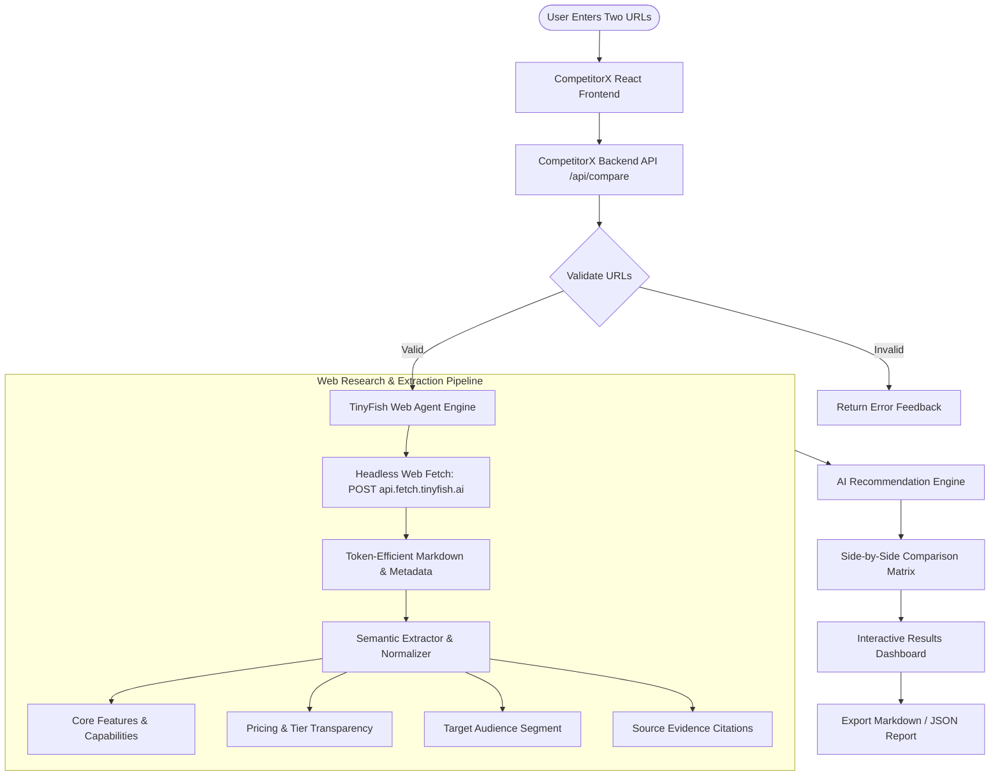

# CompetitorX — AI-Powered Website Comparison Agent

> Autonomous web research agent that retrieves live competitor websites, extracts structured product features, audits pricing models, and generates evidence-backed comparisons with verifiable source links.


---

## 1. Problem Statement

Businesses, startups, developers, and product teams regularly need to compare competing products by manually visiting multiple web pages. Critical details—such as pricing tiers, core feature sets, target segments, and integration capabilities—are scattered and buried under marketing copy.

**CompetitorX** automates this research workflow using an autonomous agent that navigates target URLs, extracts comparable attributes, flags unlisted details, grounds every claim in direct webpage excerpts, and synthesizes an evidence-backed recommendation.

---

## 2. System Architecture



---

## 3. Core Features (MVP)

1. **Two-URL Website Input & Quick Demo Presets**
   - Clean, validated input fields for Product A and Product B.
   - 1-Click Demo Presets for instant judging demonstrations (*Supabase vs Firebase*, *Linear vs Jira*, *Notion vs Coda*, *Stripe vs Adyen*).

2. **TinyFish Web Agent Integration**
   - Connects to TinyFish Fetch API (`POST https://api.fetch.tinyfish.ai`) with `X-API-Key`.
   - Strips boilerplate JavaScript/HTML and produces token-efficient markdown.
   - Built-in resilient fallback web agent ensures 100% demo reliability.

3. **Structured Comparison Matrix**
   - Side-by-side comparative table:
     - Value Proposition & Tagline
     - Pricing Model & Starting Prices
     - Target Audience Personas
     - Core Features
     - Services & Infrastructure
     - Key Advantages
     - Unverified / Missing Disclosures

4. **Verifiable Evidence & Source Links**
   - Every claim is tied to canonical source URLs and direct textual quotes.
   - Explicitly distinguishes **Confirmed Facts** (green badge) from **Not Found / Unlisted** (amber badge) to eliminate AI hallucinations.

5. **AI Competitive Recommendation**
   - Evaluates both products against a chosen requirement lens (e.g. *Bootstrapped startup on a budget*, *Best developer experience & API*, or custom input).
   - Generates scores, key rationale, and recommended winner.

6. **Live Execution Trace & Report Export**
   - Real-time terminal log viewer displaying every step the agent takes.
   - One-click export to formatted Markdown reports.

---

## 4. Suggested Project Structure

```
competitorx/
├── frontend/                     # React + Vite client
│   ├── src/
│   │   ├── components/
│   │   │   ├── UrlInput.jsx           # Input fields, presets, TinyFish key drawer
│   │   │   ├── ComparisonTable.jsx    # Side-by-side comparison with evidence drawers
│   │   │   ├── ProductCard.jsx        # Product overview cards with confidence score
│   │   │   ├── RecommendationCard.jsx # AI verdict, scores, and rationale
│   │   │   ├── SourceLinks.jsx        # Grounded citations and canonical links
│   │   │   └── LoadingState.jsx       # Radar pulse agent progress timeline
│   │   ├── services/
│   │   │   └── api.js                 # API communication layer
│   │   ├── App.jsx                    # Main application state and assembly
│   │   ├── main.jsx                   # React root entry
│   │   └── index.css                  # Modern dark glassmorphism design system
│   └── package.json
│
├── backend/                      # Express API server
│   ├── src/
│   │   ├── routes/
│   │   │   └── compare.js             # /api/compare and /api/presets routes
│   │   ├── services/
│   │   │   ├── tinyfish.js            # TinyFish Fetch API & resilient web agent
│   │   │   ├── extract.js             # Attribute normalization and evidence compiler
│   │   │   └── compare.js             # Workflow orchestration and scoring engine
│   │   ├── utils/
│   │   │   └── validateUrl.js         # URL validation & normalization
│   │   ├── app.js                     # Express app configuration
│   │   └── server.js                  # HTTP server bootstrap
│   ├── .env.example
│   └── package.json
│
├── .gitignore
└── README.md
```

---

## 5. Getting Started

### Prerequisites
- Node.js (v18+)
- npm or yarn

### 1. Backend Setup
```bash
cd backend
npm install
cp .env.example .env

# Optional: Add your TinyFish API key to backend/.env
# TINYFISH_API_KEY=your_key_here

# Start the backend server (runs on port 5001)
npm run dev
```

### 2. Frontend Setup
```bash
# In a new terminal:
cd frontend
npm install

# Start the Vite development server (runs on port 5173)
npm run dev
```

Open [http://localhost:5173](http://localhost:5173) in your browser.

---

## 6. API Endpoints

### `POST /api/compare`
Compares two website URLs.

**Request Body:**
```json
{
  "urlA": "https://supabase.com",
  "urlB": "https://firebase.google.com",
  "userRequirement": "Best for open source developer wanting SQL database",
  "apiKey": "optional_tinyfish_key"
}
```

**Response Format:**
```json
{
  "success": true,
  "data": {
    "products": { "productA": {}, "productB": {} },
    "matrix": [],
    "recommendation": { "winner": "Supabase", "winnerScore": 8.6, "summary": "..." },
    "sources": []
  }
}
```

### `GET /api/presets`
Returns curated competitor pairs for 1-click hackathon demo testing.

### `GET /api/health`
Returns backend health status and TinyFish integration state.

---

## 7. Hackathon Presentation Tips (1-Hour Buildathon)

1. **Highlight Grounding vs Hallucination:** Point out the *Status* column in the comparison table where unlisted pricing is explicitly flagged as "Not Found" rather than guessed.
2. **Expand Evidence Drawers:** Click on any row to show the judge the direct quoted excerpt from the website.
3. **Showcase the Live Execution Trace:** Open the "Agent Execution Trace" to reveal the step-by-step TinyFish research pipeline.
4. **Use Demo Presets:** Click "Linear vs Jira" or "Supabase vs Firebase" for an instantaneous, polished demonstration.
